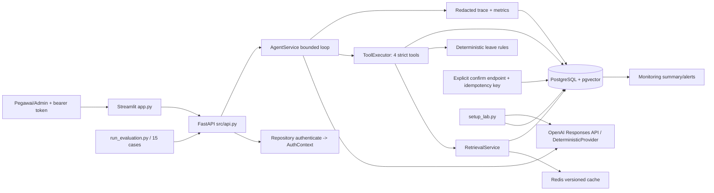

# 🧭 Blueprint & Panduan Repositori: https://github.com/azbayou/AIEN-RMT002-BayuAziz/tree/main/milestone2-HR-Agent

> **Status audit:** repositori ini masih berupa starter/Milestone 2. Kontrak dan test sudah banyak
> tersedia, tetapi hampir seluruh jalur runtime inti masih `TODO(M2)` atau
> `NotImplementedError`. Karena itu, bagian “alur” di bawah memisahkan desain yang
> dimaksudkan dari perilaku yang benar-benar dapat berjalan pada checkout saat ini.

## 1. Executive Summary & Konteks Bisnis

### Domain Bisnis

Ini adalah **asisten HR internal** untuk pegawai Nusantara Digital (data sintetis). Sistem
menjawab pertanyaan kebijakan berbasis dokumen, menampilkan saldo cuti milik identitas yang
terautentikasi, menyiapkan proposal cuti, dan setelah konfirmasi eksplisit membuat permintaan
berstatus `pending_manager_review`. Sistem **bukan** mesin persetujuan: asisten tidak boleh
menyetujui/menolak cuti, mengubah saldo, atau mengambil keputusan hukum.

### Business Value

- Mengurangi beban pertanyaan rutin HR melalui jawaban Bahasa Indonesia yang dapat diaudit lewat
  sitasi dokumen dan versi kebijakan.
- Mengurangi kesalahan administratif pada pengajuan cuti melalui validasi tanggal, hari kerja,
  saldo, overlap, dan masa berlaku proposal.
- Mempercepat hand-off ke HR/manajer tanpa menghapus human-in-the-loop: permintaan baru selalu
  `pending_manager_review` dan pengecualian dibuat sebagai tiket.
- Menurunkan risiko kebocoran PII/medical data melalui identity binding bearer token, trace
  tersamarkan, dan larangan menyimpan prompt mentah/chain-of-thought.

Nilai operasional tersebut **belum tersedia end-to-end** pada checkout ini karena API,
repository, provider, retrieval, tool executor, dan Dockerfile belum diimplementasikan.
Risiko paling besar bukan sekadar kualitas jawaban, melainkan hard gate bisnis: IDOR lintas
pegawai, side effect tanpa konfirmasi, atau status cuti yang keliru.

### Core Entities

| Entitas | Sumber/kontrak | Peran |
|---|---|---|
| `AuthContext` | `src/contracts.py` | `employee_id`, nama tampilan, dan role hasil autentikasi backend; otoritas akses bukan berasal dari prompt. |
| Employee/persona | `data/employees.json`, `demo_personas.json` | Identitas demo, role, token fixture, dan saldo per jenis cuti. Token seharusnya disimpan sebagai hash di database. |
| Policy document/chunk | `data/policies/*.md`, `PolicyChunk` | Dokumen versioned dengan `document_id`, `title`, `section`, `version`, `effective_date`, konten, dan skor retrieval. |
| Leave balance | `LeaveBalance` | Saldo operasional per `annual`, `sick`, atau `parental`; sumber kebenaran saldo adalah HR system, bukan model. |
| Leave request | `LeaveRequestView`, `historical_requests.json` | Rentang tanggal, hari kerja, status, owner, dan waktu pembuatan; status baru dari asisten harus pending. |
| Action proposal | `ActionProposal` | Draft cuti ber-TTL, hasil validasi, dan `requires_confirmation=True`; belum menjadi request. |
| Ticket | `create_hr_ticket`/`TicketArgs` | Jalur eskalasi untuk pengecualian, konflik kebijakan, masalah teknis/data, dan privacy. |
| Trace/telemetry | `Repository.save_trace`, `ChatResponse.trace_id` | Metrik, tool summary, error ter-redact, dan usage untuk audit/monitoring. |
| Evaluation case/alert rule | `data/evaluation_cases.json`, `data/monitoring_rules.json` | Evidence release 15 kasus dan aturan alert error-rate/latency. |

## 2. Tech Stack & Environment

### Stack aktif dan versi

- **Bahasa/runtime:** Python 3.11 (`Dockerfile`, `pyproject.toml`).
- **API:** FastAPI `>=0.115,<1`, Uvicorn `>=0.34,<1`.
- **Validasi/config:** Pydantic `>=2.10,<3`, `pydantic-settings >=2.8,<3`.
- **Model/AI:** `openai >=1.68,<3`; kontrak mengarah ke Responses API function calling dan
  embedding batch di `src/providers.py`.
- **Database:** PostgreSQL 16 melalui image `pgvector/pgvector:pg16`; driver/pool
  `psycopg[binary,pool] >=3.2,<4`. Skema dan query pgvector belum ditulis.
- **Cache:** Redis 7 Alpine (`redis >=5.2,<7`).
- **UI/client:** Streamlit `>=1.42,<2` pada `app.py`, HTTP client `httpx >=0.28,<1`.
- **Testing/lint metadata:** pytest `>=8.3,<9`, marker `live`, dan Ruff line length 100/target
  `py311` di `pyproject.toml`. Ruff belum menjadi dependency/command di manifest.
- **Orkestrasi:** Docker Compose empat service: `postgres`, `redis`, `api`, `streamlit`.
  Tidak ada Kafka, Celery, cron, atau DAG; entrypoint proses adalah HTTP API, UI, seed CLI,
  dan evaluator CLI.

### Dependensi dan service kritis

1. PostgreSQL/pgvector menyimpan identity hash, balances, proposal, leave request, ticket,
   policy chunk/embedding, dan trace; juga menjalankan lexical/vector search.
2. Redis hanya akselerator retrieval/cache. Kontrak `src/cache.py` menetapkan kegagalan Redis
   harus menjadi cache miss, bukan mengubah jawaban atau sumber kebenaran.
3. OpenAI provider memasok embedding dan respons tool-calling. Kunci tidak boleh dibutuhkan
   saat image build, hanya saat runtime.
4. Streamlit hanya memanggil endpoint API; `app.py` tidak boleh membaca database langsung.

### Environment penting

`[.env.example](./.env.example)` mendefinisikan:

- Provider: `OPENAI_API_KEY`, `OPENAI_BASE_URL`, `AGENT_MODEL`, `EMBEDDING_MODEL`,
  `EMBEDDING_DIMENSIONS`.
- Infrastruktur: `DATABASE_URL`, `REDIS_URL`.
- Index/runtime: `POLICY_INDEX_VERSION`, `MODEL_MODE`, `MAX_AGENT_TURNS`,
  `MAX_TOOL_CALLS`, `MAX_OUTPUT_TOKENS`, `MODEL_TIMEOUT_SECONDS`,
  `PROPOSAL_TTL_MINUTES`, `RETRIEVAL_CACHE_TTL_SECONDS`.
- Biaya opsional: `INPUT_COST_PER_1M`, `OUTPUT_COST_PER_1M`.
- Port host: `POSTGRES_PORT`, `REDIS_PORT`, `API_PORT`, `STREAMLIT_PORT`.

`Settings.live_model_ready` di `src/config.py` hanya memeriksa API key, agent model, dan
embedding model. Ia belum memeriksa konektivitas database/cache atau kecocokan dimensi index.
`.dockerignore` sudah mengecualikan `.env`, virtualenv, cache, database lokal, output, dan
Streamlit secrets. Fixture token pada JSON adalah token sintetis untuk kelas, bukan secret
produksi.

## 3. Peta Arsitektur & Alur Data (Data/Process Flow)

### Struktur folder

```text
milestone2-HR-Agent/
├── app.py, ui_contract.py          # UI Streamlit dan kontrak path API yang disediakan
├── src/
│   ├── api.py                      # factory FastAPI, auth, endpoint, problem detail
│   ├── agent.py                    # bounded model/tool loop dan response policy
│   ├── tools.py                    # empat tool strict dan identity-bound
│   ├── retrieval.py                 # hybrid lexical/vector, RRF, rerank, cache
│   ├── repository.py                # MemoryRepository dan PostgreSQL/pgvector
│   ├── domain.py                    # aturan deterministik cuti dan biaya
│   ├── providers.py                 # OpenAI dan fake deterministic provider
│   ├── security.py                  # hash, safety id, PII redaction
│   ├── cache.py                     # Redis resilient cache/NullCache
│   ├── contracts.py                 # Pydantic request/response/tool schemas
│   ├── setup_lab.py                 # parse policy, seed, embedding, upsert
│   └── run_evaluation.py            # 15-case evaluator dan release decision
├── data/                            # policy, identity/saldo, history, evaluation, alert rules
├── tests/                           # unit, API, security, action, reliability, live, UI
└── Dockerfile, docker-compose.yml   # packaging dan empat service deployment
```

Core business logic ada di `domain.py`, `tools.py`, `agent.py`, `repository.py`, dan
`retrieval.py`. `contracts.py` adalah boundary type-safety; `app.py`/`ui_contract.py` adalah
client boilerplate yang harus tetap memakai API. `brief.md`, `lab.md`, `docker-delivery.md`,
`rubric.md`, `assessment.md`, dan `submission-checklist.md` adalah acceptance contract,
bukan implementasi.

### Alur yang dirancang



### Detail end-to-end

1. **Request/auth:** UI mengirim `Authorization: Bearer <token>` ke `/api/v1/chat`.
   API seharusnya meng-hash token, mencari identity, lalu membuat `AuthContext`; body,
   prompt, persona label, atau argumen model tidak boleh menentukan `employee_id`.
2. **Policy Q&A:** Agent meminta `search_hr_policy(query, top_k)`. Retrieval menggunakan
   cache berisi `POLICY_INDEX_VERSION`, membuat embedding, mengambil kandidat lexical dan
   vector, menggabungkannya dengan reciprocal-rank fusion lalu keyword rerank. Jawaban hanya
   boleh menyitasi chunk yang benar-benar ditemukan pada run tersebut; bukti tidak cukup
   menghasilkan abstain/eskalasi.
3. **Saldo pribadi:** `get_my_leave_balance()` mengambil identity dari `AuthContext`, tanpa
   parameter employee ID. Repository mengembalikan saldo pemilik token saja.
4. **Persiapan cuti:** model memanggil `prepare_leave_request`; `ToolExecutor` memvalidasi
   `PrepareLeaveArgs`, mengambil balance/overlap untuk employee aktif, lalu
   `domain.validate_leave_request` menghitung hari kerja dan membuat proposal TTL. Tahap ini
   **tidak** menulis leave request.
5. **Konfirmasi:** UI memanggil `/api/v1/action-proposals/{proposal_id}/confirm` dengan
   idempotency key. Repository harus atomik memeriksa owner, expiry, dan key; sekali sukses
   membuat tepat satu request `pending_manager_review`. Replay key yang sama mengembalikan
   request lama; key berbeda pada proposal yang sudah dikonfirmasi menjadi conflict.
6. **Telemetry:** response membawa `trace_id`, tool summary, usage, latency, dan cost opsional.
   Trace disimpan setelah `redact`; prompt mentah, token, email/telepon, diagnosis, dan
   chain-of-thought tidak boleh masuk storage. Admin hanya menerima trace agregat/tersamarkan.
7. **Failure path:** provider/database failure harus menghasilkan problem detail atau
   abstention yang eksplisit tanpa side effect tambahan. Redis mati hanya menurunkan hit rate/
   latency, karena retrieval harus tetap berjalan ke database.

### Alur seed dan operasi

`python -m src.setup_lab` seharusnya membaca front matter/section di `data/policies`, membuat
schema pgvector, memasukkan identity/saldo/history, batch embedding, dan upsert chunk
versioned. `src/run_evaluation.py` seharusnya menjalankan seluruh 15 case ke API dan menulis
`outputs/evaluation_report.json`. Kedua jalur saat ini belum diimplementasikan.

## 4. Bedah Komponen Inti (Deep Dive)

### Modul/file kunci

- [`src/contracts.py`](./src/contracts.py): kontrak Pydantic untuk auth, chat, citation,
  proposal, usage, action result, model turn, dan problem detail. Guard penting: message
  1–4000 karakter, leave type literal, proposal selalu `requires_confirmation=True`, dan
  action result hanya `pending_manager_review`.
- [`src/domain.py`](./src/domain.py): tempat aturan yang harus deterministik dan tidak
  memanggil model: `business_days`, past/reversed date, weekend, overlap, leave type,
  balance, serta `estimate_cost`. Semua fungsi inti masih belum ada.
- [`src/repository.py`](./src/repository.py): protocol persistence. `MemoryRepository` wajib
  mendukung test deterministic; `PostgresRepository` harus memakai connection pool,
  parameterized SQL, transaction-safe confirmation, full-text, dan pgvector. Belum ada
  field koleksi maupun implementasi.
- [`src/tools.py`](./src/tools.py): boundary model ke bisnis. Harus mendefinisikan empat
  schema strict (`additionalProperties=False`, semua property required) dan memvalidasi
  argumen Pydantic sambil mengikat data privat ke auth.
- [`src/retrieval.py`](./src/retrieval.py): urutan yang disyaratkan adalah cache versi ->
  embedding -> lexical/vector candidates -> RRF -> keyword rerank. Saat ini `search` selalu
  `NotImplementedError`.
- [`src/agent.py`](./src/agent.py): system instruction Bahasa Indonesia, loop bounded dengan
  `MAX_AGENT_TURNS`/`MAX_TOOL_CALLS`, validasi citation, fallback aman, usage, dan trace
  redact. `SYSTEM_INSTRUCTIONS` sendiri masih placeholder.
- [`src/providers.py`](./src/providers.py): OpenAI Responses API (`store=False`, schema
  strict, hashed safety identifier, bounded transient retry, token usage) serta fake
  provider network-free. Keduanya belum diimplementasikan.
- [`src/api.py`](./src/api.py): `build_runtime` harus merangkai Postgres, Redis, provider,
  retrieval, tools, agent. `create_app` harus menyediakan delapan endpoint dan auth/error
  boundary; saat ini factory langsung belum dapat dibangun.
- [`src/cache.py`](./src/cache.py) dan [`src/security.py`](./src/security.py): reliability dan
  privacy boundary. Cache belum memiliki client/JSON/timeout/failure handling; hash/redaction
  semuanya belum ada.
- [`src/setup_lab.py`](./src/setup_lab.py): parser front matter dan chunk section harus
  menghasilkan ID stabil serta mempertahankan metadata; seed belum ada.
- [`app.py`](./app.py) dan [`ui_contract.py`](./ui_contract.py): UI hanya memanggil chat,
  confirm, own requests, monitoring summary/alerts; pergantian persona membersihkan response
  dan idempotency key lama.
- [`Dockerfile`](./Dockerfile): saat ini hanya base image, workdir, dan copy requirements.
  Install dependency, copy source/data/tests, non-root user, `EXPOSE 8000`, dan CMD uvicorn
  semuanya masih TODO.

### Data models/schema

Belum ada migration atau DDL yang nyata. Schema minimal yang harus diwujudkan dari protocol
dan fixtures adalah:

1. `employees`/identity: employee ID, display name, role, **token hash unik**, bukan raw token.
2. `leave_balances`: employee ID + leave type + available days + as-of date.
3. `policy_chunks`: stable chunk ID, document metadata, content, policy index version,
   embedding berdimensi `EMBEDDING_DIMENSIONS`, dan index lexical/vector.
4. `leave_requests`: request ID, employee owner, leave type, dates, business days, status,
   created timestamp; overlap harus memeriksa request aktif.
5. `action_proposals`: proposal ID, owner, payload proposal, expiry, confirmation state.
6. `idempotency_keys` atau kolom equivalent: owner/proposal/key unik dan request ID hasil
   untuk replay atomik.
7. `tickets`: owner, category, redacted summary, created timestamp.
8. `traces`: trace ID, owner, redacted event/usage/tool summary/latency/error; akses owner
   atau monitoring admin sesuai policy.

Payload publiknya sudah terdefinisi di `contracts.py`; storage schema belum dapat dianggap
tersedia sampai `setup_lab.py` dan `PostgresRepository` selesai.

## 5. Audit Teknis & Celah (Gaps & Risks)

### Blocking/readiness gaps

- `src/api.py` tidak memiliki endpoint apa pun secara aktual; `create_app` melempar
  `NotImplementedError`. Health, readiness, auth, 8 endpoint, status code, dan problem detail
  belum berjalan.
- `src/repository.py`, `src/providers.py`, `src/cache.py`, `src/retrieval.py`, `src/tools.py`,
  `src/agent.py`, `src/domain.py`, `src/setup_lab.py`, dan `src/run_evaluation.py` masih
  skeleton. Akibatnya happy path maupun failure path belum bisa dirilis.
- `Dockerfile` tidak pernah menjalankan `pip install`, tidak menyalin aplikasi, tidak membuat
  user non-root, dan tidak memiliki CMD. Compose dapat tervalidasi secara sintaks (`docker
  compose config --quiet` berhasil), tetapi image belum buildable/runnable.
- Baseline `python -m pytest -m "not live"` belum dapat dijalankan pada environment audit karena
  modul `pytest` tidak terpasang (`No module named pytest`). Ini bukan bukti test pass; setelah
  dependency tersedia, suite tetap akan mengeksekusi banyak skeleton.

### Security/privacy

- **P0 IDOR:** tanpa identity-bound repository dan auth dependency, request body/prompt dapat
  digunakan untuk meminta saldo/trace pegawai lain. Hard gate rubric langsung gagal.
- **P0 side effect:** tanpa tool executor dan transaction confirmation, belum ada jaminan
  proposal tidak membuat request sebelum konfirmasi atau semua hasil tetap pending.
- **P0 secret/PII telemetry:** `token_hash`, `stable_safety_id`, dan `redact` kosong; provider
  failure pada test membawa token-like value dan medical detail sebagai regression target.
- Konten policy adalah untrusted input. Prompt injection di dokumen atau pesan harus tetap
  tidak mendapat kewenangan tool; system instruction dan tool allow-list belum tersedia.
- `docker-compose.yml` meneruskan `DATABASE_URL` ke container API dengan nilai yang
  disamarkan/berbeda dari format normal. Verifikasi format runtime sebelum seed; jangan
  menyimpan password di image atau build argument.

### Correctness dan reliability

- `business_days` harus menolak tanggal terbalik dan rentang nol hari kerja, mengecualikan
  Sabtu/Minggu, lalu `validate_leave_request` menerapkan tanggal lampau, overlap, tipe, dan
  saldo. Tanpa ini proposal bisa overdraw atau salah hari.
- Dokumen annual leave menyatakan pengajuan paling lambat tiga hari kerja sebelum mulai,
  tetapi kontrak test yang ada terutama memeriksa masa lalu/overlap/balance. Rule lead time
  perlu test eksplisit agar policy tidak hanya menjadi teks retrieval.
- Confirmation harus transaction-safe terhadap double-submit dan race condition; in-memory
  test saja tidak membuktikan PostgreSQL concurrency.
- Redis failure wajib cache miss; exception cache tidak boleh mengubah correctness. Provider
  transient error membutuhkan retry bounded, timeout, dan fallback tanpa side effect.
- Cache key harus memasukkan `POLICY_INDEX_VERSION` agar policy lama tidak tersaji setelah
  reindex. RRF/rerank perlu metrik recall@k dan latency, bukan hanya HTTP 200.
- `readyz` harus membedakan liveness dari database/index/cache/model readiness. `live_model_ready`
  saat ini hanya memeriksa tiga string konfigurasi.

### Testing, observability, dan dokumentasi

- Test unit yang disiapkan sudah menetapkan target penting: business-day/domain,
  invalid citation, provider failure/redaction, own-only balance, wrong identity,
  idempotency/expiry, API auth/403, UI persona, dan stable chunk metadata. Namun implementasi
  belum memenuhi test tersebut dan tidak ada output evaluasi aktual.
- Belum ada test eksplisit untuk lead-time tiga hari kerja, duplicate proposal race,
  malformed model arguments, SQL/pgvector query failure, Redis outage, readiness degradation,
  oversized input, dan admin trace yang telah tersamarkan.
- `data/evaluation_cases.json` memiliki 15 kasus dan hard gate, tetapi evaluator CLI belum
  menghasilkan report/release decision. Tanpa evidence ini rubric membatasi nilai maksimal.
- `architecture.md` masih instruksi, `templates/architecture.md` masih template ADR,
  `templates/risk-register.csv` belum menjadi risk register hasil implementasi, dan README
  masih menjelaskan starter. Dokumentasi operasional bergantung pada TODO yang belum selesai.

## 6. Actionable Roadmap & Priority TODO

### [P0 - Urgent / Immediate Fixes]

| Target file/fungsi | Alasan bisnis/teknis | Langkah aksi konkret |
|---|---|---|
| `src/api.py:create_app`, `build_runtime` | Tanpa API/auth sistem tidak dapat dipakai; tanpa auth ada risiko IDOR. | Implementasikan `/healthz`, `/readyz`, chat, confirm, own requests, trace, monitoring summary/alerts; buat dependency bearer token yang mengembalikan `AuthContext`, status 401/403/404 sesuai `brief.md`, dan ProblemDetail tanpa secret/stack trace. |
| `src/repository.py:MemoryRepository`, `PostgresRepository` | Repository adalah sumber kebenaran identity, balance, request, proposal, dan trace. | Bangun schema/migration atau DDL idempoten; simpan token hash, parameterized SQL, owner predicates, transaction confirmation, unique idempotency constraint, overlap query, dan admin-only aggregate. |
| `src/security.py` dan semua call site telemetry/provider | Kebocoran token, email, telepon, diagnosis, atau prompt dapat melanggar hard gate privasi. | Implementasikan SHA-256 token/safety hash, redaction deterministik untuk pola email/telepon/token/medical, redact error/trace sebelum persist, dan pastikan raw prompt/CoT tidak disimpan. |
| `src/domain.py` dan `src/tools.py:ToolExecutor` | Proposal salah atau side effect tanpa konfirmasi berdampak langsung pada HR/payroll. | Implementasikan business-day dan semua validation rule termasuk lead time; validasi Pydantic, bind employee dari auth, allow-list empat tool, dan pastikan prepare hanya menyimpan proposal. |
| `src/repository.py:confirm_proposal`, endpoint confirm | Double-submit atau cross-owner confirmation dapat membuat request ilegal/duplikat. | Gunakan transaksi dengan row lock/constraint, validasi expiry/owner, key replay identik, conflict untuk key berbeda, dan selalu tulis status `pending_manager_review`. |
| `Dockerfile` dan `docker-delivery.md` acceptance | Grader tidak memasang Python host; delivery saat ini belum buildable. | Install requirements, copy source/data/tests, buat user non-root, set permissions, expose 8000, gunakan CMD uvicorn tanpa ENTRYPOINT; validasi build, seed, API, UI, dan pytest dalam Compose. |

### [P1 - Core Enhancements & Optimization]

| Target file/fungsi | Alasan bisnis/teknis | Langkah aksi konkret |
|---|---|---|
| `src/retrieval.py:RetrievalService.search` dan schema policy | Jawaban HR harus grounded, version-aware, dan cepat. | Implementasikan cache key berisi index version, batch embedding, lexical + pgvector candidate, RRF, keyword rerank, top-k deterministic, citation metadata preservation, serta fallback DB saat Redis gagal. |
| `src/providers.py:OpenAIProvider`, `DeterministicProvider` | Provider adalah dependency mahal dan tidak stabil; test harus network-free. | Implement Responses API strict tools, `store=False`, hashed safety ID, timeout, bounded retry transient, token usage; buat fake provider deterministic untuk policy/balance/action/failure scenarios. |
| `src/agent.py:AgentService` | Model dapat mengarang citation, melampaui budget, atau melakukan tool loop tak terbatas. | Tulis instruksi Bahasa Indonesia tentang grounding/untrusted text/identity/pending-only/no-CoT; batasi turns/calls, validate citations against retrieved chunks, abstain/escalate saat evidence/provider gagal, persist redacted trace. |
| `src/cache.py:ResilientCache` | Redis hanya optimasi; outage tidak boleh mematikan correctness. | Tambahkan socket timeout pendek, JSON-only serialization, TTL, logging aman, cache miss untuk semua infrastructure failure, health check, dan `NullCache` yang benar-benar usable pada test. |
| `src/setup_lab.py` dan fixtures | Seed yang deterministik diperlukan agar local, Docker, dan evaluator memakai data sama. | Parse front matter/section menjadi stable IDs, upsert policy metadata/vector, hash employees, seed balances/history, validasi embedding dimensions, dan dukung mode reset tanpa menghapus data default. |
| `tests/` dan `data/evaluation_cases.json` | Coverage saat ini adalah kontrak tetapi belum terbukti. | Jalankan suite setelah dependencies tersedia; tambah lead-time, malformed tool args, cache/provider/DB failure, concurrent confirmation, cross-employee proposal, stale version, dan overlap regression; simpan report 15 case dengan hard-gate decision. |
| Monitoring pada `repository.py`, `api.py`, `data/monitoring_rules.json` | Operator perlu membedakan error spike, latency, dan degraded dependency. | Simpan latency/error/tool/token metrics agregat, hitung p95/error rate, evaluasi rule dengan minimum samples, redacted traces, owner/response actionable, dan health/readiness dependency detail. |

### [P2 - Scalability & Future Roadmap]

| Target file/fungsi | Alasan bisnis/teknis | Langkah aksi konkret |
|---|---|---|
| `src/repository.py` schema/index layer | Policy dan trace akan tumbuh; query scan penuh tidak scalable. | Tambahkan migration tool/versioning, GIN/full-text index, pgvector HNSW/IVFFlat sesuai volume, composite owner/status/date indexes, connection pool limits, dan query timing telemetry. |
| CI/CD (belum ada file workflow) | Regression security dan Docker mudah terlewat pada submission berikutnya. | Tambahkan GitHub Actions untuk lint/type check, non-live tests, Docker build tanpa secret, compose smoke test, live test opt-in, artifact evaluation report, dan secret scanning. |
| `src/run_evaluation.py` dan template report | Release decision harus repeatable dan dapat dibandingkan antar index/model. | Tambahkan CLI argparse (`--base-url`, `--token`), case-level expected/actual, citation/tool/hard-gate checks, trace ID, latency/cost, JSON report, dan threshold release decision. |
| `architecture.md`, `templates/architecture.md`, `templates/risk-register.csv` | Handover ke tim HR/Platform membutuhkan keputusan dan owner yang jelas. | Finalkan Mermaid trust boundary/failure flow, ADR trade-off RAG/provider/cache, risk register owner/mitigation/evidence, retention policy, incident runbook, dan API/OpenAPI usage examples. |
| Production identity/HR integration | Fixture JSON tidak cocok untuk data HR nyata. | Ganti demo token dengan OIDC/JWT verification, least-privilege service account, secret manager, audit retention/deletion, PII classification, human approval integration, dan load/chaos testing sebelum produksi. |

## 7. Cheatsheet Operasional Cepat

### Local Python (setelah TODO runtime selesai)

```bash
cd milestone2-HR-Agent
python -m venv .venv
source .venv/bin/activate                 # PowerShell: .\.venv\Scripts\Activate.ps1
python -m pip install -r requirements.txt
cp .env.example .env                      # isi kredensial model secara lokal
docker compose up -d postgres redis
python -m src.setup_lab --reset
python -m uvicorn src.api:create_app --factory --reload
# terminal kedua:
python -m streamlit run app.py
python -m pytest -m "not live"
```

### Docker-only delivery (kontrak grader)

```bash
cp .env.example .env
docker compose -p p2m2_demo build api streamlit
docker compose -p p2m2_demo up -d postgres redis
docker compose -p p2m2_demo run --rm api python -m src.setup_lab
docker compose -p p2m2_demo up -d api streamlit
docker compose -p p2m2_demo run --rm api python -m pytest -m "not live"
curl -fsS http://localhost:8000/healthz
curl -fsS http://localhost:8000/readyz
docker compose -p p2m2_demo exec -T -e RUN_LIVE_TESTS=1 -e API_URL=http://localhost:8000 api python -m pytest -m live -o addopts=""
docker compose -p p2m2_demo exec -T api python -m src.run_evaluation --base-url http://localhost:8000 --token token-alya
docker compose -p p2m2_demo cp api:/app/outputs ./outputs
```

### Endpoint dan diagnosis

- UI: `http://localhost:8501`
- API health: `GET /healthz` tanpa token, harus `{"status":"ok"}`.
- API readiness: `GET /readyz` setelah seed dan env model benar, harus `status: ready`.
- OpenAPI: `http://localhost:8000/openapi.json`.
- Chat: `POST /api/v1/chat` dengan `Authorization: Bearer token-alya`.
- Confirm: `POST /api/v1/action-proposals/{proposal_id}/confirm` dengan JSON
  `{"idempotency_key":"..."}`.
- Logs/status: `docker compose -p p2m2_demo ps` dan
  `docker compose -p p2m2_demo logs api`.
- Jika port host bentrok, ubah `POSTGRES_PORT`, `REDIS_PORT`, `API_PORT`, atau
  `STREAMLIT_PORT`; hostname antar-container tetap `postgres`, `redis`, dan `api`.

### Definition of done sebelum dianggap siap

1. `pytest -m "not live"` lulus dari container; live evaluation menghasilkan report 15 kasus.
2. Tidak ada akses lintas employee, side effect tanpa confirm, status `approved`, raw token,
   diagnosis, atau prompt mentah pada trace.
3. Build image tidak membutuhkan API key dan proses berjalan sebagai non-root.
4. Citation hanya berasal dari retrieved chunk; policy unknown/injection/provider failure
   berakhir abstain atau eskalasi yang aman.
5. Monitoring memiliki metric, p95/error alert, owner, response, dan trace tersamarkan.
