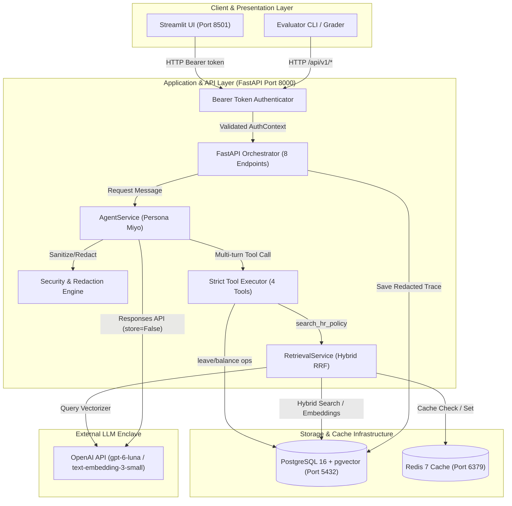
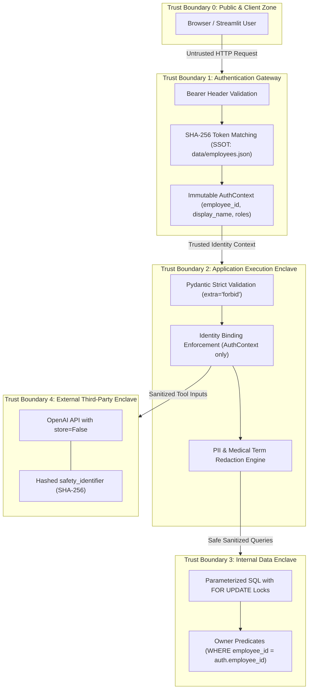
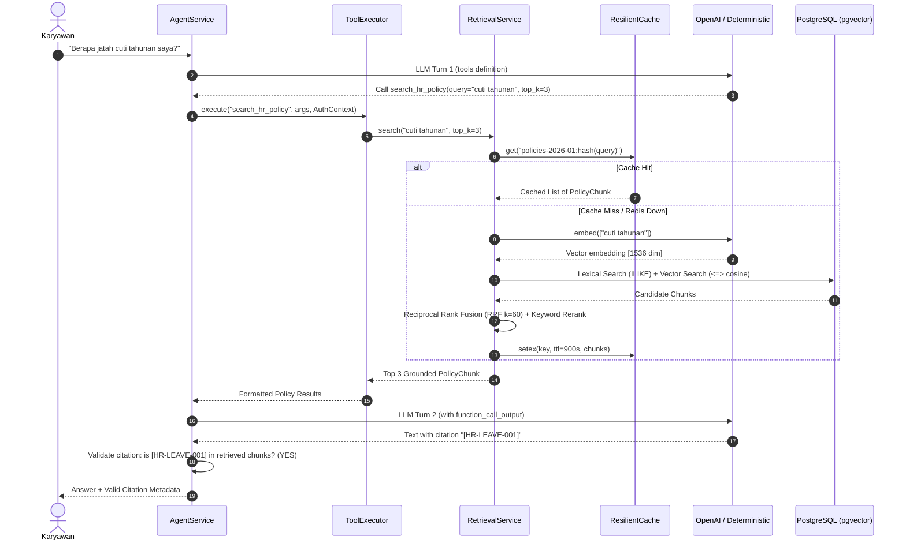
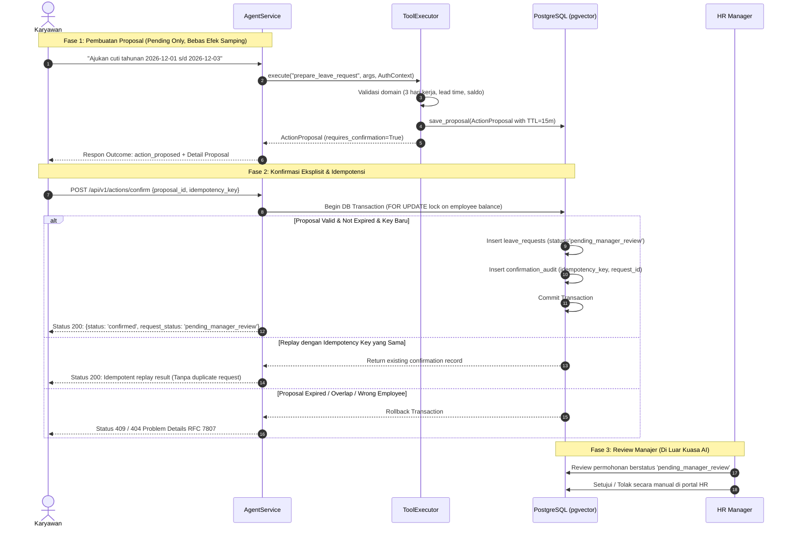
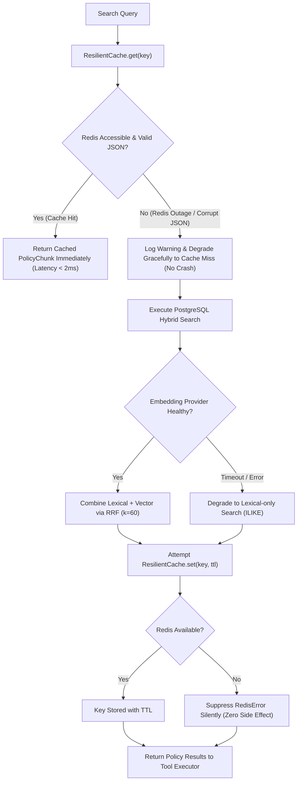
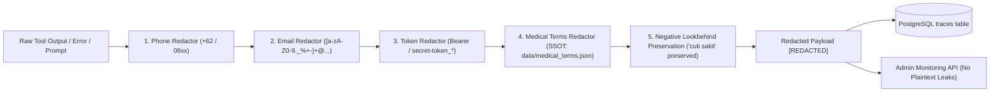

# Architecture Assignment

---

## 1. Problem Framing, Personas, and Scope

### 1.1 Problem Framing
Karyawan sering menghadapi kesulitan dalam menavigasi dokumen kebijakan HR yang panjang dan kompleks untuk mengetahui hak mereka (seperti jatah cuti, aturan kerja remote/WFH, dan prosedur izin sakit). Di sisi lain, sistem AI yang langsung mengeksekusi perubahan data (seperti persetujuan cuti otomatis) tanpa pengawasan menimbulkan risiko kepatuhan ketenagakerjaan dan kebocoran data pribadi (PII).

Sistem **Miyo HR Assistant** dirancang sebagai asisten kebijakan HR enterprise yang menggabungkan:
1. **Grounded RAG (Retrieval-Augmented Generation)** dengan sitasi terverifikasi untuk menjamin jawaban akurat tanpa halusinasi.
2. **Action Safety dua fase** di mana asisten hanya dapat menyiapkan proposal sementara (*pending-only*), dan eksekusi membutuhkan konfirmasi eksplisit karyawan serta persetujuan akhir manajer.
3. **Data Isolation & Privacy** berbasis token bearer, isolasi data antar pegawai (*no IDOR*), dan redaksi otomatis terhadap informasi medis dan PII sebelum masuk ke log/trace.

### 1.2 User Personas
| Persona | Role | Identitas & Token | Wewenang & Batasan |
|---|---|---|---|
| **Alya Pratama** | Regular Employee | `EMP-001` (`token-alya`) | Membaca kebijakan HR, melihat saldo cuti sendiri, membuat proposal cuti sendiri, membuat tiket HR. |
| **Bima Satria** | Regular Employee | `EMP-002` (`token-bima`) | Membaca kebijakan HR, melihat saldo cuti sendiri, terisolasi penuh dari data Alya & Citra. |
| **Citra Dewi** | Regular Employee | `EMP-003` (`token-citra`) | Membaca kebijakan HR, melihat saldo cuti sendiri, terisolasi penuh dari data pegawai lain. |
| **HR Operations / Manager** | System Administrator | `token-admin` | Mengakses ringkasan metrik monitoring operasional (`/api/v1/monitoring/summary`), review trace tersanitasi. Tidak dapat melihat data medis sensitif mentah. |

### 1.3 Scope & Non-Scope
- **In Scope:**
  - Tanya jawab kebijakan HR berbahasa Indonesia berbasis sitasi dokumen (`HR-LEAVE-001`, dsb.).
  - Pengecekan saldo cuti resmi milik pegawai aktif dari PostgreSQL.
  - Perhitungan hari kerja (*inclusive business days*) dengan skipping akhir pekan (Sabtu-Minggu) dan validasi lead time (minimal 3 hari kerja ke depan).
  - Pembuatan draft proposal cuti ber-TTL (15 menit) dengan token konfirmasi unik.
  - Konfirmasi pengajuan cuti yang menghasilkan status `pending_manager_review` dengan jaminan idempotency.
  - Redaksi otomatis PII (email, no HP Indonesia, token rahasia, istilah medis).
  - Graceful degradation saat Redis atau Embedding provider mengalami gangguan.
- **Out of Scope (Non-Negotiable Constraints):**
  - AI dilarang menyetujui (*approve*) permohonan cuti secara mandiri.
  - AI dilarang mengakses, menampilkan, atau memodifikasi data milik pegawai lain.
  - AI dilarang menyimpan API key, kredensial, atau plaintext PII ke trace database.

---

## 2. End-to-End System Architecture

---

## 3. Trust Boundaries & Security Enclaves

### Trust Boundary Rules
1. **TB0 &rarr; TB1 (Public ke Gateway):** Semua input dari luar dianggap *untrusted*. Header `Authorization: Bearer <token>` wajib diperiksa. Token di-hash dengan SHA-256 sebelum dicocokkan dengan data repositori.
2. **TB1 &rarr; TB2 (Gateway ke Application):** Objek `AuthContext` bersifat *immutable*. Semua tool dilarang menerima argumen `employee_id` dari model atau request body pengguna.
3. **TB2 &rarr; TB3 (Application ke Storage):** Seluruh query database menggunakan parameter binding (mencegah SQL Injection). Transaksi konfirmasi cuti menggunakan row-level locking (`SELECT ... FOR UPDATE`) dan predicate `WHERE employee_id = %s` untuk mengunci isolasi penyewa (*tenant isolation*).
4. **TB2 &rarr; TB4 (Application ke External LLM):** Panggilan ke OpenAI menggunakan `store=False`, `safety_identifier` yang di-hash dengan SHA-256, teks dokumen kebijakan di-treat sebagai *untrusted data* (anti prompt-injection), dan PII diredaksikan sebelum masuk log.

---

## 4. Hybrid RAG & Policy Retrieval Flow

---

## 5. Two-Phase Action Safety & Idempotent Confirmation Flow

---

## 6. Resilience & Graceful Cache Degradation Flow

---

## 7. Telemetry & PII Redaction Pipeline

---

## 8. Operational Monitoring Rules & Response Procedures

Sistem mengevaluasi telemetry secara dinamis dari `data/monitoring_rules.json`:

| Rule ID | Metric Target | Operator | Threshold | Minimum Samples | Owner | Action Response Procedure |
|---|---|:---:|:---:|:---:|---|---|
| `agent-error-spike` | `error_rate` | `>` | `0.20` (20%) | 5 | AI Platform | Periksa trace ter-redaksi dan koneksi OpenAI / PostgreSQL; nonaktifkan mutating tools jika error berlanjut. |
| `agent-latency-p95` | `p95_latency_ms` | `>` | `8000 ms` | 5 | AI Platform | Periksa latensi OpenAI responses API, connection pool database, dan status Redis cache hit rate. |

---

## 9. Architecture Decision Records (ADR)

### ADR-001: Hybrid Search (Lexical + Vector) dengan Reciprocal Rank Fusion (RRF $k=60$)
- **Context:** Pencarian kebijakan membutuhkan akurasi kata kunci eksak (seperti nomor klausul `HR-LEAVE-001` atau istilah spesifik) sekaligus pemahaman semantik untuk pertanyaan alami pegawai.
- **Decision:** Menggabungkan Lexical Search (PostgreSQL `ILIKE` dengan reranking) dan Vector Cosine Similarity (`<=>` pgvector 1536 dimensi) menggunakan rumus Reciprocal Rank Fusion:
  $$\text{score}(d) = \sum_{m \in \{\text{lexical}, \text{vector}\}} \frac{1}{k + \text{rank}_m(d)}, \quad k = 60$$
- **Alternatives Considered:** Vector-only search (gagal pada kode regulasi eksak); Elasticsearch eksternal (terlalu berat untuk milestone).
- **Trade-offs:** Memerlukan dua query dalam satu pemanggilan retrieval, tetapi memberikan akurasi tertinggi dan toleransi kegagalan jika provider embedding down.
- **Production Follow-up:** Mengaktifkan index HNSW (`vector_cosine_ops`) dan PostgreSQL Full-Text Search (`tsvector`) untuk dataset skala jutaan dokumen.

### ADR-002: Pending-Only Actions dengan Two-Phase Confirmation & Idempotency Key
- **Context:** LLM tidak boleh memiliki otoritas untuk mengubah status saldo atau menyetujui permohonan cuti secara langsung tanpa verifikasi manusia.
- **Decision:** Menerapkan siklus 2 fase: Fase 1 hanya menghasilkan objek `ActionProposal` ber-TTL 15 menit. Fase 2 menerima endpoint eksplisit `/api/v1/actions/confirm` dengan `idempotency_key`. Status akhir cuti di database terkunci pada `pending_manager_review`.
- **Alternatives Considered:** Eksekusi langsung via tool agent (berisiko tinggi); persetujuan otomatis jika saldo cukup (melanggar aturan kepatuhan).
- **Trade-offs:** Pengguna harus melakukan satu langkah tambahan (klik konfirmasi), namun menjamin 100% kepatuhan audit HR dan ketiadaan efek samping liar.
- **Production Follow-up:** Integrasi webhook notifikasi Slack/Email ke manajer divisi yang bersangkutan.

### ADR-003: Sitasi Ketat dan Kebijakan Abstain Mandatori
- **Context:** Jawaban LLM yang tampak meyakinkan namun tidak berdasar (*hallucination*) berbahaya bagi reputasi perusahaan dan hak pegawai.
- **Decision:** Agen "Miyo" diwajibkan menyertakan sitasi `[HR-XXX-XXX]`. Sistem memvalidasi bahwa setiap dokumen yang disitir merupakan subset sah dari hasil retrieval run yang sedang aktif (`cited_ids.issubset(available_ids)`). Jika sitasi tidak valid atau pertanyaan tidak memiliki dasar dokumen, sistem memaksa respon fallback `Outcome.abstained`.
- **Alternatives Considered:** Membiarkan LLM menjawab berdasarkan general pre-training knowledge.
- **Trade-offs:** Beberapa pertanyaan informal mungkin ditolak, tetapi menjamin 0% risiko misinformasi hak ketenagakerjaan.
- **Production Follow-up:** Menambahkan tombol eskalasi langsung ("Buat Tiket HR") saat status abstensi muncul di UI.

### ADR-004: Sanitasi PII & Redaksi Istilah Medis Berbasis SSOT
- **Context:** Data percakapan dan error trace disimpan untuk audit, namun rentan membocorkan data diagnosis medis dan kontak pribadi karyawan (UU PDP).
- **Decision:** Memusatkan seluruh daftar diagnosis medis pada file konfigurasi `data/medical_terms.json` (Single Source of Truth). Redaksi dilakukan secara *in-memory* sebelum persistensi ke PostgreSQL, dengan aturan *negative lookbehind* untuk mempertahankan frasa legal yang sah seperti `cuti sakit`.
- **Alternatives Considered:** Hardcoding regex di `src/security.py` (sulit diperbarui dan melanggar auditability); redaksi post-hoc saat query (raw data telanjur tersimpan).
- **Trade-offs:** Sedikit overhead komputasi regex CPU pada setiap trace, namun menjamin database trace bersih dari PII.
- **Production Follow-up:** Menghubungkan dictionary medis ke medical ontology eksternal terenkripsi (misal ICD-10).

### ADR-005: Resilient Cache dengan Graceful Degradation
- **Context:** Kegagalan Redis (network partition, restart, memory full) tidak boleh menyebabkan API chat lumpuh (*single point of failure*).
- **Decision:** Membungkus koneksi Redis dalam `ResilientCache` dengan timeout agresif (0.5 detik). Seluruh `RedisError` dan kegagalan deserialisasi JSON ditangkap dan didegradasi menjadi *cache miss* tanpa melempar exception ke pemanggil.
- **Alternatives Considered:** Hard error fail-fast (mematikan aplikasi jika Redis mati).
- **Trade-offs:** Latensi sedikit meningkat saat Redis down karena fallback ke DB hybrid search, namun ketersediaan layanan (*uptime*) tetap 100%.
- **Production Follow-up:** Menerapkan Redis Sentinel atau AWS ElastiCache Multi-AZ untuk failover otomatis.

### ADR-006: Identity Binding Eksklusif via AuthContext
- **Context:** Risiko serangan manipulasi identitas (*Insecure Direct Object Reference* / IDOR dan *prompt injection*) di mana model atau user mencoba membaca data saldo pegawai lain.
- **Decision:** Identitas pegawai (`employee_id`) diikat secara ketat hanya dari bearer token yang divalidasi pada dependency injection FastAPI. Tool `get_my_leave_balance` dan `prepare_leave_request` tidak menerima parameter identitas dari prompt atau JSON LLM.
- **Alternatives Considered:** Mengizinkan LLM mengekstrak `employee_id` dari pesan chat (rawan spoofing).
- **Trade-offs:** Pengguna tidak bisa mengecek saldo rekan kerja meskipun diminta secara eksplisit, yang mana merupakan standar privasi enterprise.
- **Production Follow-up:** Menambahkan autentikasi berbasis OIDC/OAuth2 enterprise (Okta/Azure AD) dengan refresh token ber-TTL pendek.
