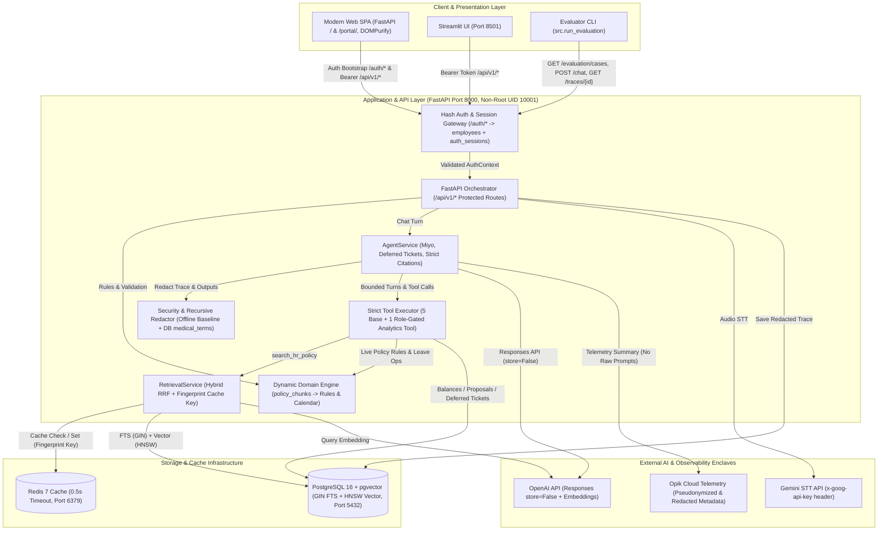
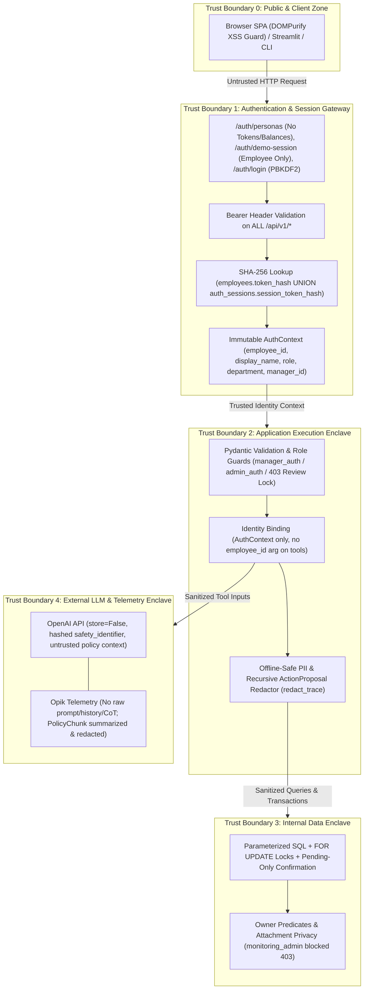
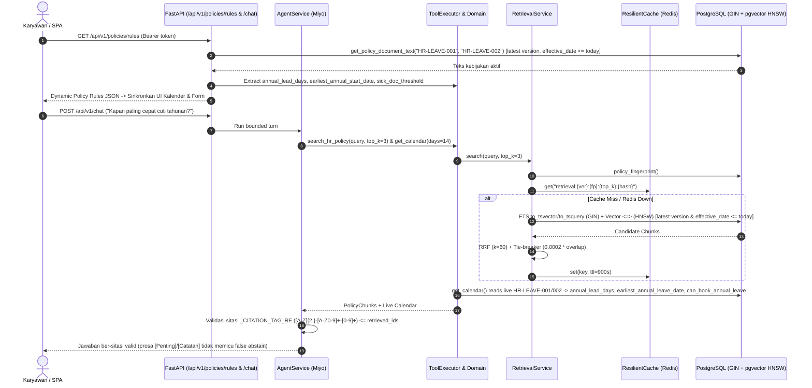
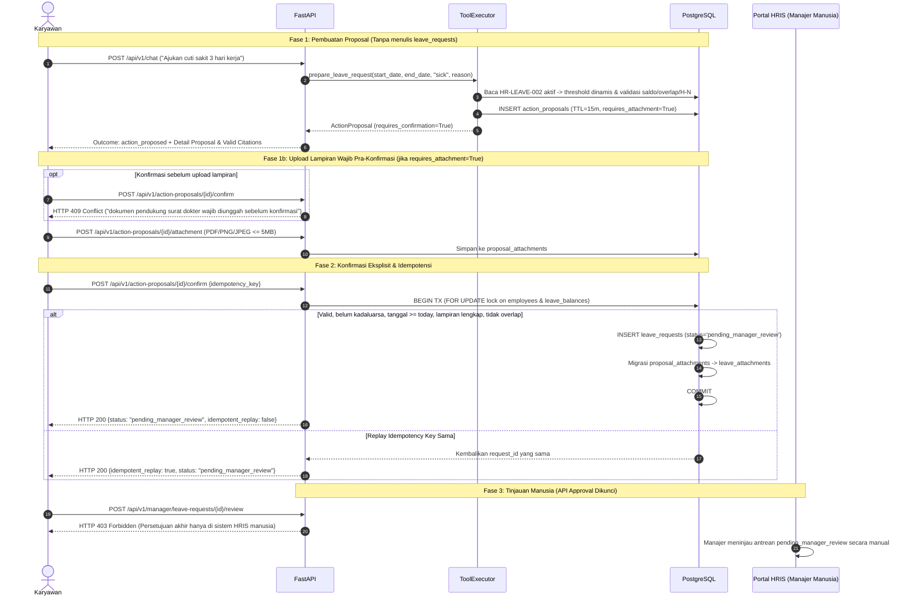
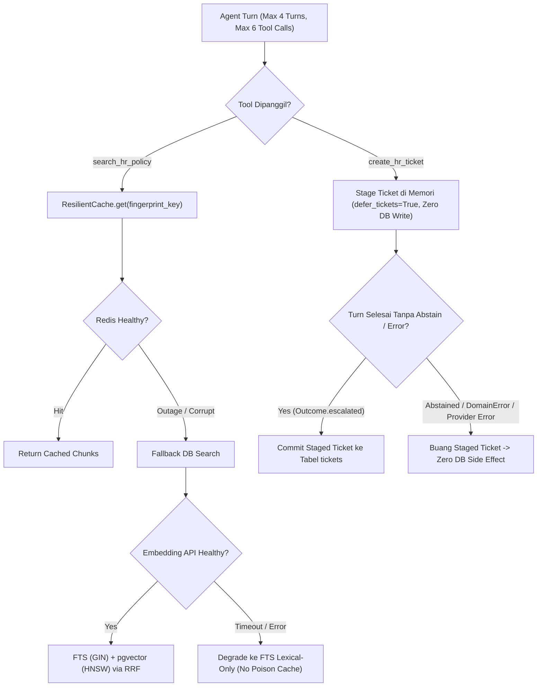
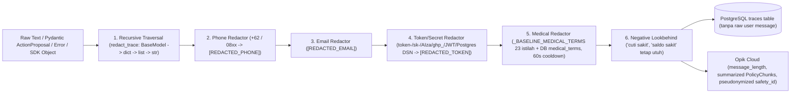

# Architecture Assignment

---

## 1. Problem Framing, Personas, and Scope

### 1.1 Problem Framing
Karyawan sering menghadapi kesulitan menavigasi dokumen kebijakan HR untuk mengetahui hak cuti, aturan kerja jarak jauh (WFH), dan ketentuan izin sakit beserta dokumen pendukungnya. Di sisi lain, sistem AI yang langsung menyetujui cuti, menyimpan teks medis sensitif tanpa redaksi, atau membocorkan data antar pegawai menimbulkan risiko kepatuhan ketenagakerjaan dan privasi (UU PDP).

Sistem **Miyo HR Assistant** dirancang sebagai asisten kebijakan HR enterprise yang menggabungkan:
1. **Grounded Hybrid RAG** berbasis PostgreSQL (`to_tsvector` GIN + `pgvector` HNSW + RRF) dengan sitasi terverifikasi `[DOCUMENT_ID]` dan abstensi wajib bila bukti tidak valid.
2. **Dynamic DB Policy Matrix** di mana aturan lead time cuti tahunan (`HR-LEAVE-001`) dan ambang surat dokter cuti sakit (`HR-LEAVE-002`) dibaca langsung dari `policy_chunks` aktif di database sehingga perubahan kebijakan langsung memperbarui validasi domain, kalender, API `/api/v1/policies/rules`, dan UI SPA tanpa perubahan kode.
3. **Two-Phase Action Safety & Pending-Only Gate** di mana asisten hanya menyiapkan `ActionProposal` ber-TTL, mewajibkan upload lampiran medis pra-konfirmasi jika diperlukan, dan mengunci seluruh pengajuan pada status `pending_manager_review` tanpa kemampuan approval otomatis di API.
4. **Zero-Trust Identity Isolation & Recursive Redaction** berbasis hash token (`employees.token_hash` dan `auth_sessions`), redaksi offline-safe (`_BASELINE_MEDICAL_TERMS` + tabel `medical_terms`), dan sanitasi rekursif sebelum penyimpanan trace maupun pengiriman ke Opik.

### 1.2 User Personas
| Persona | Role | Identitas & Autentikasi | Saldo Awal (`employees.json`) | Wewenang & Batasan |
|---|---|---|---|---|
| **Alya Pratama** | `employee` | `EMP-001` (Demo SSO `POST /auth/demo-session` atau Bearer token ter-hash) | Annual `8 hari`, Sick `10 hari`, Parental `60 hari` | Membaca kebijakan HR, melihat saldo & request pribadi, mengajukan proposal & lampiran cuti sakit, membuat tiket HR, melihat trace pribadi. |
| **Bima Santoso** | `employee` | `EMP-002` (Demo SSO `POST /auth/demo-session` atau Bearer token ter-hash) | Annual `3 hari`, Sick `10 hari`, Parental `60 hari` | Akses mandiri atas data pribadi; terisolasi penuh dari saldo, proposal, lampiran, dan trace milik Alya. |
| **Monitoring Admin** | `monitoring_admin` | `ADM-001` (Wajib login password `POST /auth/login` pada UI; demo session diblokir `403`) | `-` | Mengakses `/api/v1/monitoring/summary|rules|alerts`, analitik agregat, tiket operasional, dan trace tersanitasi. Diblokir (`403`) dari lampiran medis pegawai dan approval cuti. |

### 1.3 Scope & Non-Scope
- **In Scope:**
  - Tanya jawab kebijakan HR berbahasa Indonesia dengan sitasi `[DOCUMENT_ID]` yang terverifikasi pada chunk retrieval aktif.
  - Pengecekan saldo cuti resmi milik pegawai aktif (`get_my_leave_balance` tanpa argumen identitas).
  - Perhitungan hari kerja (`business_days`, `count_lead_business_days`, `compute_earliest_annual_leave_date`) berdasarkan aturan lead time H-N dinamis dari `policy_chunks`.
  - Pembuatan `ActionProposal` ber-TTL (15 menit) tanpa menulis ke `leave_requests` sebelum konfirmasi.
  - Upload lampiran pra-konfirmasi (`POST /api/v1/action-proposals/{proposal_id}/attachment` ke `proposal_attachments`) sebelum konfirmasi cuti sakit melebihi ambang batas kebijakan.
  - Konfirmasi idempoten (`POST /api/v1/action-proposals/{proposal_id}/confirm`) yang membuat satu row `leave_requests` berstatus `pending_manager_review` dan memigrasikan lampiran ke `leave_attachments`.
  - Pembuatan tiket HR (`create_hr_ticket`) yang ditunda selama turn agent dan hanya di-commit bila turn berakhir sukses tanpa abstensi (`Outcome.escalated`).
  - Redaksi otomatis PII (email, nomor HP, token/API key/JWT/DSN, istilah medis) serta graceful degradation saat Redis atau Embedding provider terganggu.
- **Out of Scope (Non-Negotiable Constraints):**
  - API dan AI dilarang menyetujui (`approved`) permohonan cuti; endpoint `/api/v1/manager/leave-requests/{id}/review` dikunci HTTP `403`.
  - AI dan pegawai dilarang membaca saldo, request, lampiran, atau trace milik pegawai lain.
  - `monitoring_admin` dilarang mengunduh lampiran medis pegawai (`GET /api/v1/leave-requests/{id}/attachment` mengembalikan `403`).
  - Sistem dilarang menyimpan plaintext API key, password, demo token (`persona_tokens` dihapus), prompt mentah, atau chain-of-thought di DB maupun Opik.

---

## 2. End-to-End System Architecture

---

## 3. Trust Boundaries & Security Enclaves

### Trust Boundary Rules
1. **TB0 → TB1 (Public ke Gateway):** Seluruh input pengguna, file lampiran (magic bytes PDF/PNG/JPEG, maks 5 MB), dan audio dianggap *untrusted*. Markdown pada Web SPA disanitasi dengan `DOMPurify.sanitize(...)`. Seluruh rute `/api/v1/*` (termasuk `/api/v1/policies/rules` dan `/api/v1/evaluation/cases`) wajib menyertakan Bearer token yang valid; hanya hash SHA-256 yang disimpan pada `employees.token_hash` dan `auth_sessions.session_token_hash` (`persona_tokens` dihapus).
2. **TB1 → TB2 (Gateway ke Application):** `AuthContext` bersifat *immutable*. Tool `get_my_leave_balance` (`additionalProperties: false`) dan `prepare_leave_request` tidak pernah menerima parameter `employee_id` dari LLM. Endpoint `/api/v1/manager/leave-requests/{id}/review` dikunci HTTP `403` agar approval otomatis mustahil dilakukan melalui API.
3. **TB2 → TB3 (Application ke Storage):** Seluruh query SQL menggunakan parameter binding. Transaksi `/confirm` mengunci baris `employees` dan `leave_balances` dengan `FOR UPDATE`, memvalidasi tanggal tidak berada di masa lalu, memverifikasi `proposal_attachments` untuk cuti sakit berlampiran wajib, mengecek overlap (`pending_manager_review` & `approved`), memigrasikan lampiran ke `leave_attachments`, dan mengunci status baru pada `pending_manager_review`. Akses `GET /api/v1/leave-requests/{id}/attachment` memblokir `monitoring_admin` dengan `403`.
4. **TB2 → TB4 (Application ke External LLM/Opik):** Panggilan OpenAI menggunakan `store=False` dan `safety_identifier` ber-hash SHA-256. Dokumen kebijakan diperlakukan sebagai *untrusted data*. Sebelum dikirim ke Opik Cloud, `OpikTracker` menghapus `user_message`, `history`, dan array `messages` mentah, meringkas `PolicyChunk`, lalu menjalankan `redact_trace(...)` secara rekursif.

---

## 4. Hybrid RAG, Dynamic Policy Matrix & Citation Flow

---

## 5. Two-Phase Action Safety, Attachment Gate & Idempotent Confirmation Flow

---

## 6. Resilience, Deferred Side Effects & Graceful Degradation Flow

---

## 7. Telemetry & Recursive PII Redaction Pipeline

---

## 8. Operational Monitoring Rules & Response Procedures

Aturan monitoring di-seed dari `data/monitoring_rules.json` ke tabel PostgreSQL `monitoring_rules` oleh `src/setup_lab.py` (dengan default in-memory pada `MemoryRepository`):

| Rule ID | Metric Target | Operator | Threshold | Minimum Samples | Owner | Action Response Procedure |
|---|---|:---:|:---:|:---:|---|---|
| `agent-error-spike` | `error_rate` | `>` | `0.20` (20%) | 5 | AI Platform | Periksa trace ter-redaksi dan kesehatan provider/PostgreSQL; nonaktifkan mutating tools jika error berlanjut. |
| `agent-latency-p95` | `p95_latency_ms` | `>` | `8000 ms` | 5 | AI Platform | Periksa latensi LLM/embedding provider, retrieval cache hit rate, dan timing query database. |

---

## 9. Architecture Decision Records (ADR)

### ADR-001: Hybrid Search (PostgreSQL FTS GIN + pgvector HNSW) dengan RRF ($k=60$)
- **Context:** Pencarian kebijakan memerlukan ketepatan istilah/kode regulasi eksak (seperti `HR-LEAVE-001`) sekaligus pemahaman semantik Bahasa Indonesia, serta harus tetap mengembalikan hanya dokumen dengan `effective_date <= active_today` dan `version` terbaru.
- **Decision:** Menggabungkan PostgreSQL Full-Text Search (`to_tsvector('simple', ...)` dengan index GIN `policy_chunks_fts_idx`) dan Vector Cosine Similarity (`<=>` dengan index HNSW `policy_chunks_embedding_hnsw_idx`) melalui Reciprocal Rank Fusion ($k=60$) dan tie-breaker keyword `0.0002 * overlap`.
- **Alternatives Considered:** Vector-only search (lemah pada kode regulasi eksak); `ILIKE` scan penuh (tidak menggunakan index FTS).
- **Trade-offs:** Memerlukan maintenance index GIN/HNSW saat seeding, namun memberikan akurasi recall tinggi dan fallback leksikal otomatis bila embedding provider mengalami outage.
- **Production Follow-up:** Penambahan *stemming*/kamus Bahasa Indonesia khusus atau *cross-encoder reranker* bila korpus mencapai ribuan dokumen.

### ADR-002: Pending-Only Actions, Pra-Konfirmasi Lampiran & Idempotent Confirmation
- **Context:** Agen AI tidak boleh menyetujui cuti secara sepihak, dan cuti sakit di atas ambang batas kebijakan wajib disertai surat dokter sebelum masuk antrean tinjauan.
- **Decision:** Memisahkan fase proposal (`ActionProposal` ber-TTL 15 menit) dari fase konfirmasi (`POST /api/v1/action-proposals/{id}/confirm`), menambahkan tabel `proposal_attachments` + endpoint upload pra-konfirmasi, mengunci status akhir pada `pending_manager_review`, dan mengunci endpoint `/api/v1/manager/leave-requests/{id}/review` ke HTTP `403`.
- **Alternatives Considered:** Upload lampiran sesudah `/confirm` (menimbulkan status `pending_manager_review` tanpa lampiran valid); mengizinkan endpoint API mengubah status menjadi `approved` (melanggar Hard Gate pending-only).
- **Trade-offs:** Menambah satu langkah upload sebelum `/confirm` pada cuti sakit panjang, tetapi menjamin kepatuhan penuh terhadap kebijakan HR.
- **Production Follow-up:** Integrasi webhook satu arah ke sistem HRIS eksternal tempat manajer manusia melakukan persetujuan akhir.

### ADR-003: Dynamic DB Policy Matrix (`policy_chunks` → Domain/Calendar/API → SPA)
- **Context:** Menanam angka kebijakan (seperti H-3 atau `>2 hari`) di prompt atau kode Python menyebabkan inkonsistensi ketika HR memperbarui dokumen kebijakan.
- **Decision:** Memusatkan sumber aturan pada tabel `policy_chunks`. Fungsi `get_policy_document_text`, `policy_fingerprint`, `get_annual_leave_lead_days`, `get_sick_leave_doc_threshold`, dan `count_lead_business_days` mengekstrak aturan secara dinamis untuk validasi tool, hasil `get_calendar`, endpoint `GET /api/v1/policies/rules`, dan sinkronisasi UI Web SPA.
- **Alternatives Considered:** Hardcoding konstanta pada `SYSTEM_INSTRUCTIONS` dan frontend JS.
- **Trade-offs:** Format redaksi angka/kalimat pada kebijakan baru perlu mengikuti pola Bahasa Indonesia standar yang didukung parser `_parse_policy_number`.
- **Production Follow-up:** Menyimpan metadata aturan terstruktur (*structured policy schema*) di samping teks Markdown saat ingestion HR.

### ADR-004: Hash-Only Auth Sessions & Privacy-First Telemetry Redaction
- **Context:** Menyimpan token demo plaintext (`persona_tokens`), membiarkan `/api/v1/*` tanpa autentikasi, atau mengandalkan query DB tanpa fallback pada `redact()` menimbulkan risiko kebocoran kredensial dan data medis.
- **Decision:** Menghapus tabel `persona_tokens`, menyimpan sesi ber-TTL hanya dalam bentuk hash SHA-256 di `auth_sessions`, mewajibkan `Depends(current_auth)` pada seluruh rute `/api/v1/*`, memblokir `monitoring_admin` dari lampiran medis (`403`), menyediakan 23 `_BASELINE_MEDICAL_TERMS` in-memory dengan cooldown DB 60 detik, dan menerapkan `redact_trace` rekursif + ringkasan Opik tanpa prompt mentah.
- **Alternatives Considered:** Menyimpan token plaintext untuk kemudahan demo; redaksi hanya pada string tingkat atas.
- **Trade-offs:** Akun `monitoring_admin` memerlukan login password pada Web SPA (tidak ada 1-klik demo session), namun menjamin isolasi hak akses istimewa.
- **Production Follow-up:** Integrasi SSO OIDC/OAuth2 enterprise (Okta/Azure AD) dan ontologi medis terenkripsi (ICD-10 / SNOMED-CT).

### ADR-005: Deferred Side-Effect Tickets & Resilient Cache Degradation
- **Context:** Pembuatan tiket langsung di tengah turn berisiko meninggalkan tiket yatim jika turn berikutnya gagal atau abstain, sementara kegagalan Redis tidak boleh melumpuhkan layanan chat.
- **Decision:** Menunda penulisan `create_hr_ticket` (`defer_tickets=True`) hingga seluruh loop agent selesai tanpa status `abstained` (lalu memancarkan `Outcome.escalated`), serta membungkus Redis dalam `ResilientCache` ber-timeout 0.5 detik yang mendegradasi error menjadi *cache miss*.
- **Alternatives Considered:** Menulis tiket segera saat pemanggilan tool; fail-fast jika Redis mati.
- **Trade-offs:** Memerlukan state `staged_tickets` selama satu siklus `AgentService.run()`, namun menjamin properti *zero side effects on abstention*.
- **Production Follow-up:** Redis Sentinel/Cluster HA serta *circuit breaker* cooldown untuk Redis outage berkepanjangan.
